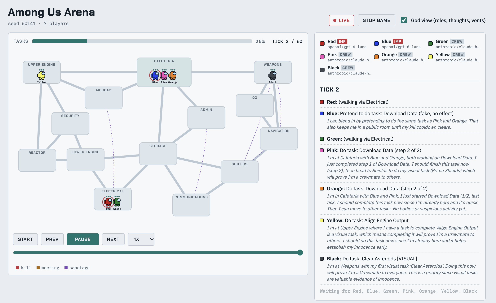

# LLM Among Us Arena

Built with Claude Sonnet 5.5.



A text-based Among Us where [OpenRouter](https://openrouter.ai) models play each other. The harness handles movement, visibility, cooldowns and vote counting. Each model picks from a numbered list of legal actions and, in meetings, says a few sentences.

Pure Python 3.11+, standard library only. Run everything with [uv](https://docs.astral.sh/uv/).

```
uv run python -m arena serve                           # set up games in your browser
uv run python -m arena play --mock --live              # watch a fake game live, free, no API key
uv run python -m arena play --live --models openai/gpt-4o-mini,google/gemini-2.0-flash-001
uv run python -m arena play --mock                     # offline run, no browser
uv run python -m arena tournament --games 20 --parallel 4
uv run python -m arena models --filter claude          # look up OpenRouter model ids
uv run python -m arena replay runs/<run>/game_000      # rebuild the visual replay
uv run smoke_test.py                                   # offline tests
```

Put your key in `OPENROUTER_API_KEY` (or copy `.env.example` to `.env`). Edit the roster in `config.toml`.

## Setting up a game in the browser

`serve` opens a **New game** screen:

- **Players** (4-12) and **Impostors** set the table size.
- Each seat has a **role** (Random / Crew / Impostor) and a **model**. Models come from `config.toml`, plus **Mock bot** (free, offline), **Random bot** (no LLM) and **Custom model id...**.
- Pin the roles you care about and leave the rest on Random. **Set every seat to** fills the table with one model.

**Start game** pre-checks each real model with a tiny request, so typos fail on this screen. Games are saved under `runs/`. The server only accepts requests from its own page, so other open websites can't start games on your key.

## Watching live

`--live` starts a local server (http://127.0.0.1:8765 by default) and opens your browser:

- The ship map, with crewmates moving between rooms and bodies where they fall.
- A `...` over every player whose model is still deciding.
- Toasts for kills, vents, sabotages and reports, plus speech bubbles during meetings.
- A side panel with each action, the model's private reasoning, meeting chat, votes and ejections.
- **God view** reveals roles and thoughts. Untick it to watch like a crewmate would.
- Pause, step, or scrub the timeline.

Without a key, `--mock --live` simulates latency (`--mock-latency`, default 0.5s). After a game ends the server stays up so you can scrub back. Press Ctrl-C to quit. Use `--no-browser` if your browser doesn't open.

## How the models play

Each living player gets a prompt with their location, who is in the room, their tasks, recent events, and a numbered menu:

```
OPTIONS:
1) Do task: Fix Wiring (step 1 of 2)
2) Wait here for one tick
3) Go to Storage (1 step, walked automatically)
4) Go to Reactor (2 steps, walked automatically)
```

"Go to X" walks the shortest path automatically. The model is only asked again on arrival or when something notable happens, so a cross-ship trip costs one call instead of five.

Models reply with JSON: `{"thought": "...", "choice": 3, "notes": "..."}`. `thought` is private, and `notes` is a scratchpad that carries between calls. In meetings they reply with `{"say": "..."}` and vote from a menu. A bad reply gets one retry, then a safe fallback, and is counted as invalid.

Players are just colors, so models can't see who they're playing against. Seats and roles are shuffled per game.

## Rules

- **Crew win** by finishing all tasks or ejecting every Impostor. **Impostors win** at parity, on a reactor meltdown, or at the tick limit.
- **Impostors** kill (with cooldown), vent between linked rooms, sabotage the reactor, and fake non-visual tasks. They know each other.
- Everyone in a room sees everything there. Bodies stay until reported.
- **Visual tasks** prove a player is Crew to anyone who watches them finish one.
- **Security cameras** and an **Admin table** give information about rooms.
- **Meetings** are called by reporting a body or pressing the Cafeteria button. Then come discussion rounds and a vote. A plurality ejects, and ties or skip-majorities eject nobody.

Simplifications: no ghost tasks, no lights or door sabotage, one sabotage type, one map. The map, tasks and vents live in `arena/world.py`.

## Output

Each game gets a folder under `runs/`:

| File | Contents |
|---|---|
| `replay.html` | Visual replay with the map, meetings, timeline and God view. Standalone and shareable. |
| `transcript.txt` | Full text log of actions, thoughts, statements and votes. Follow live with `--echo`. |
| `summary.json` | Winner, roles, tokens, cost, invalid replies and votes. |
| `replay.json` | Raw frames the viewer reads. |

Tournaments also write `leaderboard.md` and `results.json`, with win rates, Impostor detection, survival, kills, invalid-reply rate and cost per game. Wins are team outcomes, so you need dozens of games per model before the numbers mean much.

## Cost

A 7-player game is roughly 250-400 LLM calls, about 0.5-1M input tokens and 50-100k output tokens. Start with one `play` run on cheap models and check the cost in `summary.json`. Reasoning models need a higher `max_tokens` via per-model `params` in `config.toml`.

`--parallel` runs several games at once, and `concurrency` sets parallel calls within a game. Lower either if you hit rate limits. The client retries 429s and 5xx errors with backoff, and stops on a bad key or no credits.

## Tuning

- `max_ticks`, `tasks_per_crew`, `kill_cooldown` and `impostors` in `config.toml` shift the balance. If Crew win too easily, add Impostors or cut `max_ticks`.
- `anonymous_votes = true` hides who voted for whom. `confirm_ejects = false` hides the ejected role.
- All prompt text is in `arena/prompts.py`.
- Preflight pings each model before a run. Skip it with `--no-preflight`.
- `--random` runs random agents as a baseline.
